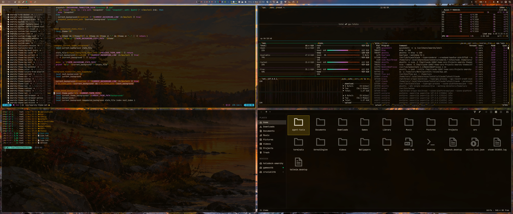

# Maine Autumn Sunrise — Omarchy theme



## Install

```
omarchy-theme-install https://github.com/lutzlstein/omarchy-maine-autumn-theme
```

Aether (adds it to your blueprints and applies it):

```
aether --import-blueprint https://raw.githubusercontent.com/lutzlstein/omarchy-maine-autumn-theme/main/blueprint.json --auto-apply
```

## Palette

| Name | Hex | Swatch |
|---|---|---|
| accent | `#eac018` |  |
| selection | `#55200a` |  |
| selection_foreground | `#c0992a` |  |
| muted | `#605e58` |  |
| background | `#0b0701` |  |
| dark_background | `#080501` |  |
| darker_background | `#060401` |  |
| lighter_background | `#23201a` |  |
| foreground | `#ded7c5` |  |
| dark_foreground | `#a7a194` |  |
| light_foreground | `#e3ddce` |  |
| bright_foreground | `#e6e1d4` |  |
| red | `#c0992a` |  |
| yellow | `#c980c7` |  |
| orange | `#c9a84a` |  |
| green | `#00c878` |  |
| cyan | `#b658ba` |  |
| blue | `#a27100` |  |
| magenta | `#0091ab` |  |
| brown | `#79652c` |  |
| bright_red | `#eac018` |  |
| bright_yellow | `#f69ffa` |  |
| bright_green | `#34f6af` |  |
| bright_cyan | `#e474ef` |  |
| bright_blue | `#cc9600` |  |
| bright_magenta | `#32b7d9` |  |

Icons: `Yaru-yellow`

## Backgrounds credits

- `Misty Autumn River at Sunrise.png`: AI-generated with ChatGPT by Cory Blische.

The background images are released under the same MIT license as the rest of this theme.

## License

MIT, see [LICENSE](LICENSE).
